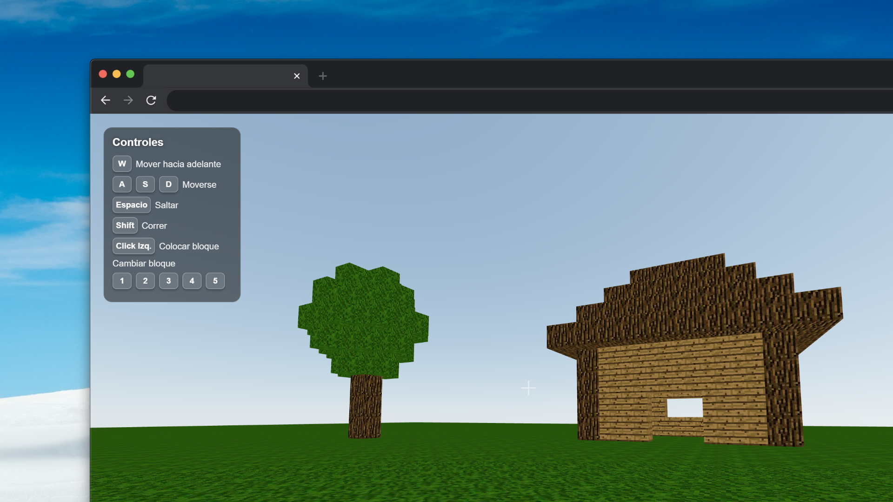

# minecraft-react

[](https://github.com/JeremyAyza/minecraft-react/actions/workflows/ci.yml)

Minecraft-style block sandbox in the browser: walk around in first person, place and remove textured blocks. React Three Fiber for rendering, Cannon.js (`@react-three/cannon`) for physics, Zustand for the block list.

**Origin:** built on midudev's live-coding project [minecraft-clone](https://github.com/midudev/minecraft-clone) (2022). My changes: TypeScript, a procedural generator for the starting house and trees, and an on-screen controls panel.

Live demo: https://minecraft-react-iuff.onrender.com



## How to run

```bash
npm ci
npm run dev     # http://localhost:5173
npm run build
```

## Controls

Click the scene to lock the mouse. **WASD** move, **Space** jumps. Click the ground to place a block, **Alt + click** a block to remove it. Textures: **1** wood, **2** log, **3** dirt, **4** glass, **5** grass.

## How it works

- **Player:** a dynamic Cannon sphere. Every frame the camera copies its position, and the WASD vector, rotated by the camera, becomes its horizontal velocity. Jumping only works when vertical velocity is near zero.
- **Blocks:** each one is a static Cannon box read from the Zustand store. Clicking the ground adds a block at the rounded hit point.
- **Starting world:** `src/default-cubes.json` (494 blocks) was generated once with `generateHouse` and `generateTrees` in `src/helpers.ts`. Trees are placed at random, so committing the output keeps the world identical on every load.

## Trade-offs

- One physics body per block is simple and fine for a few hundred blocks. It doesn't scale to chunked terrain, which would need instanced or merged geometry.
- The bundle is ~1.5 MB (three.js + Cannon) and isn't split.

## Tests

`npm test` runs Vitest on the world generator and the block store. CI runs the tests and the build (which includes the typecheck).

## Known limitations

- Blocks can only be placed on the ground, not on top of other blocks.
- Nothing is saved: a reload resets the world.
- The controls panel is in Spanish.
